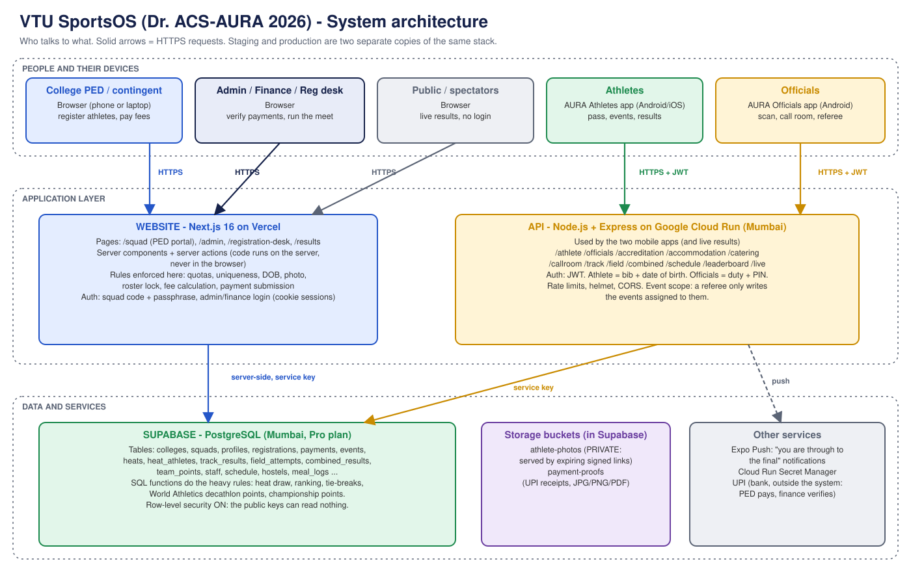
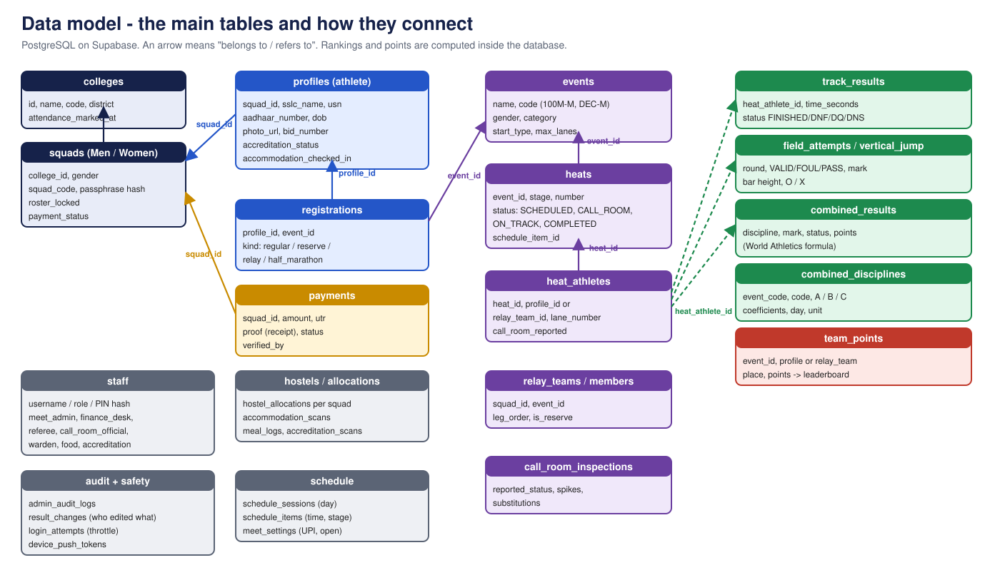
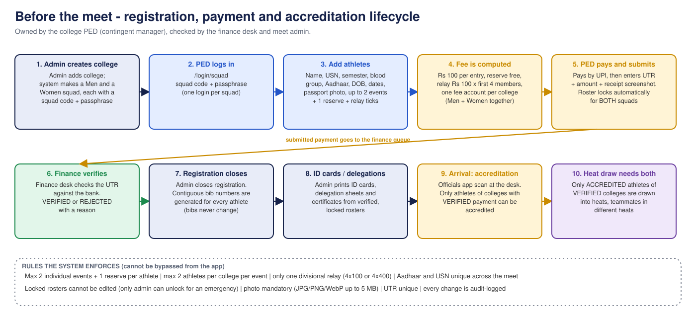
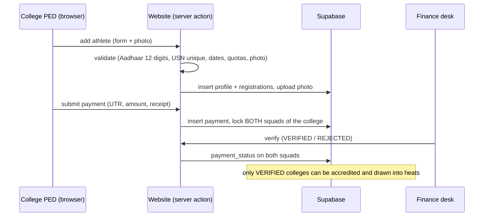
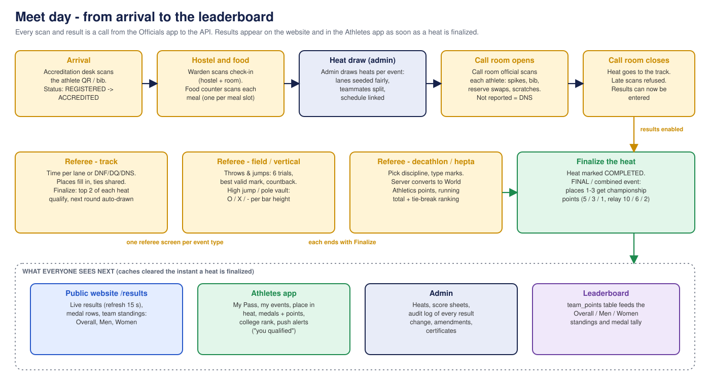
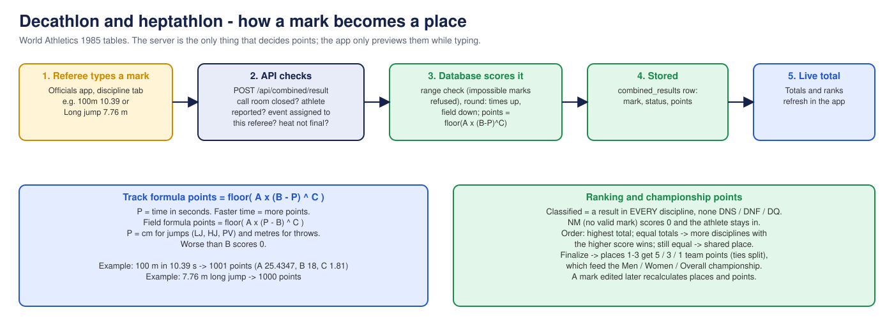

# VTU SportsOS - Architecture (technical)

The system behind the **28th VTU Inter-Collegiate State Level Athletic Meet 2026 (Dr. ACS-AURA 2026)**,
hosted by Dr. ACS College of Engineering, Bengaluru, 7-10 December 2026.

> Looking for the non-technical version, with a walkthrough for each kind of user?
> Read **[HOW-IT-WORKS.md](HOW-IT-WORKS.md)**. Deployment commands are in **[DEPLOY.md](DEPLOY.md)**.
> Business rules live in **[CLAUDE.md](CLAUDE.md)**. Every diagram below is also in [`diagrams/`](diagrams/) as SVG and PNG.

---

## 1. The big picture



There are **three programs and one database**:

| Part | Folder | Tech | Runs on | Who uses it |
|---|---|---|---|---|
| **Website** | `frontend/web` | Next.js 16 (App Router, server actions), React 19, plain CSS | Vercel | College PEDs, admin, finance desk, registration desk, public |
| **API** | `backend` | Node.js, Express, TypeScript | Google Cloud Run (Mumbai) | The two mobile apps, live results |
| **Mobile apps** | `frontend/mobile` | Expo SDK 58, React Native 0.88, Hermes, expo-router | Android (and iOS for Athletes) | Athletes; officials |
| **Database + storage** | `supabase` | PostgreSQL, SQL functions, row-level security, storage buckets | Supabase (Mumbai, Pro) | Everything above |

Two details that surprise people:

1. **The website does not call the API.** Its server actions talk to Supabase directly with the
   service key, on the server only. The registration rules (quotas, uniqueness, roster lock, fees)
   live in the website's server actions. The old registration, finance and admin routes in the
   Express API still exist for local scripts, but they are switched **off in production** (they
   answer `410 Gone`) so nobody can bypass the website's rules.
2. **One mobile codebase makes two apps.** The `APP_VARIANT` build variable (`athletes` or
   `officials`) selects which app you get. Which API a build talks to (staging or production) is fixed
   at build time by its profile in `frontend/mobile/eas.json`.

### Repository map

```text
vtu-atletics/
├── frontend/web/        Next.js website (squad portal, admin, registration desk, live results)
│   └── src/app/actions  Server actions: auth, athletes, payment, admin, schedule, bids, attendance
├── frontend/mobile/     Expo app: (tabs)/ = Athletes app, officials/ = Officials app
│   └── src/components/officials   TrackReferee, FieldReferee, VerticalReferee, CombinedReferee, CallRoomHeat...
├── backend/             Express API: routes/, middleware/ (JWT, cache), utils/ (progression, push, photo links)
├── supabase/migrations  0001..0045 SQL migrations, run by hand in order (see DEPLOY.md ledger)
├── scripts/             Staging seed/driver scripts, end-to-end test scripts, audit runner
├── diagrams/            The pictures used in these documents
├── nginx/, docker-compose.yml   Self-hosting alternative to Cloud Run (not used in production)
└── docs/                Plans, rules (vtu_rules.txt), brochures, app-store kit
```

### Environments

| | Staging (rehearsal) | Production |
|---|---|---|
| Database | Supabase project `zivnurzq...` | Supabase project `mrqkwhrm...` |
| API | Cloud Run `aura-api-staging` | Cloud Run `aura-api` |
| Website | vtu-athletics.vercel.app (push to `origin`) | acse-aura.vercel.app (push to `fortis`) |
| Apps | `officials-demo`, `athletes-demo` builds | `officials-preview/production`, `athletes-production` |

Staging holds fictional demo data. Always try a change on staging, then repeat it on production.

---

## 2. How a request travels

### Website (PED, admin, finance)
1. The browser asks Vercel for a page, for example `/squad/athletes`.
2. The layout checks the session cookie (`requireSquad()` / `requireAdmin()` in `src/lib/auth-guard.ts`).
3. The page (a server component) reads Supabase with the **service-role key**, which exists only on the server.
4. Forms call **server actions**. They validate everything again on the server and write to Supabase.
5. `revalidatePath()` refreshes the affected pages.

Row-level security is **on for every table with no policies** (migration 0036). The public anon key can
read and write nothing. Only the website's server and the API hold the service key.

### Mobile apps
1. The app sends `Authorization: Bearer <JWT>` to the API.
2. `authenticate` verifies the JWT, and `requireRole([...])` checks the role.
3. The route calls a SQL function (an RPC) or reads/writes tables through the service client.
4. Live endpoints are cached for 5-30 seconds (`cacheResponse`). Finalizing a heat clears the `live`,
   `leaderboard` and `schedule` caches immediately.

### Logins (all different on purpose)

| Who | Credentials | How it is kept | Protection |
|---|---|---|---|
| College PED | squad code + passphrase | session cookie `squad_session` | bcrypt hash, login throttle |
| Admin / finance | username + password | session cookie, re-checked against `staff` on each request | throttle, admin audit log |
| Athlete | bib + date of birth (or QR token) | JWT, role `athlete` | 8 failures per 15 min per bib (`login_attempts`) |
| Official | duty + 6-digit PIN | JWT with the role of that duty | throttle, per-role scope |

Referees can carry a **scope** of assigned events. A referee can write results only for those events
(`assertEventScope`). A heat that is finalized rejects further writes from referees. The admin's **Results & Corrections**
page (`/admin/results`, `actions/results-admin.ts`) can reopen it (back to `ON_TRACK`; refused when the next round has already
started) or correct a track final time / decathlon mark directly; a reason is required and goes in `admin_audit_logs`. Every result change is logged in `result_changes`.

---

## 3. Data model



- **colleges -> squads (Men / Women) -> profiles (athletes).** The squad carries the passphrase hash,
  `roster_locked` and `payment_status`.
- **registrations** link an athlete to an event as `regular`, `reserve`, `relay` or `half_marathon`.
  Database triggers enforce the quotas (`validate_registration_quotas`).
- **events -> heats -> heat_athletes.** An entry is an athlete or a relay team. Results sit in
  `track_results`, `field_attempts`, `vertical_jump_attempts` and (decathlon/heptathlon) `combined_results`.
- **team_points** holds the official placings and points. The Men / Women / Overall standings are computed
  from it by SQL (`get_championship_standings`).
- **payments** hold UTR, amount, proof and status per submission.
- Heavy rules are SQL functions, so a result is judged the same way whatever app sent it:
  `generate_heat_draw`, `submit_track_result`, `submit_field_attempt`, `submit_vertical_jump_attempt`,
  `compute_field_standings`, `compute_combined_standings`, `submit_combined_result`,
  `allocate_event_points`.

### Storage
- `athlete-photos` is **private**. Pages and the API return **signed links that expire** (12 h on the web, 7 days
  in the API payloads). Any new code that returns `photo_url` must sign it.
- `payment-proofs` holds UPI receipts (JPG, PNG, PDF, up to 5 MB).

---

## 4. Registration, payment and accreditation





Fee rules (`calculateSquadFees()` and `calculateCollegeFees()` in `payment.ts` / `src/lib/payments.ts`):
Rs 100 per regular or half-marathon entry; reserve Rs 0; a divisional relay Rs 100 x min(members, 4);
the mixed relay Rs 100 x min(own members, 2) per squad. **One fee account per college**: the Men's and
Women's squads are summed, either PED can pay, and verification sets the status on both.

---

## 5. Meet day



### The heat lifecycle
`SCHEDULED -> CALL_ROOM -> ON_TRACK -> (IN_PROGRESS) -> COMPLETED`

1. **Heat draw** (`generate_heat_draw`): only ACCREDITED athletes of VERIFIED colleges. Teammates are
   spread across heats, and lanes are drawn fairly (the best four go to lanes 3-6, the next two to 7-8, the rest
   to 1-2). Field, mass-start and road events are one group. The 1500 m is drawn in heats of eight.
2. **Call room** (`/callroom`): the official opens the call room, scans each athlete, records inspections
   (spikes, bib), substitutions (reserve swap, relay swap) and scratches. Closing it sends the heat to the
   track. **Strict rule:** after the close, anyone not reported is DNS and no result can be entered for
   them. If the call room tablet has no internet, the referee tablet can close it with the call room
   official's PIN (`/callroom/override-close`).
3. **Result entry** (`/track`, `/field`, `/combined`): allowed only after the call room has closed, only
   for reported entries, and only before the heat is finalized.
4. **Finalize** (`finalizeHeat()` in `backend/src/utils/progression.ts`):
   - marks the heat COMPLETED;
   - when every heat of the round is done, builds the next round (first 2 of each heat qualify, ties for
     second go through, no time qualifiers; a semi-final is added when more than eight qualify; a final never has more than eight);
   - when the FINAL (or a combined event) is complete, calls `allocate_event_points` (places 1-3);
   - clears the caches and pushes "you are through to the final" notifications to the qualifiers.

### Points
- **College points: 10 / 6 / 2** for 1st / 2nd / 3rd in any event, individual or relay (migration 0042,
  view `championship_scored_points`). Overall = every event; Men's / Women's team = that gender's individual events only.
- **Athlete's own points: 5 / 3 / 1** for individual events (Best Male / Female Athlete). `team_points.points` keeps
  these; the standings read the view's `college_points` / `athlete_points` columns.
- The Mixed Relay scores nothing.
- Ties share a place.
- A result edited after the points were awarded recalculates them automatically (database triggers).

### Field and vertical events
Throws and horizontal jumps: six trials, only the best eight continue after three, best valid mark wins,
countback on the whole series. High jump and pole vault: O / X / - per bar height with the standard
countback (highest cleared, fewest attempts at it, fewest failures).

### Decathlon and heptathlon



Scored with the World Athletics 1985 tables. The coefficients are data
(`combined_disciplines`, migration 0045), and the **server alone decides the points** (`combined_points()`).
The app shows a preview from the same coefficients so the referee sees points while typing. Marks are checked
against sane ranges, times round up and field marks round down. An athlete is classified only with a result in every discipline and no DNS, DNF or DQ. Equal totals go to the athlete with the higher score in more disciplines.

### The Officials app is built to survive bad Wi-Fi
- The athlete roster (name, bib, photo link, hostel, fee status) is downloaded and cached, so a scanner can
  still identify people offline.
- Every scan and result is an **operation in a queue on the device**. Each carries a client UUID, so the
  server ignores a second copy: resending is always safe. The queue is shown as "Queued" and empties when the network returns.
- Heat data is cached and polled every 15-20 seconds while online.
- A referee sees only the events assigned to them.

---

## 6. API reference (mobile apps)

| Prefix | Roles | Main calls |
|---|---|---|
| `/api/auth` | public | `POST /staff/login`, `POST /staff/pin-login` (`/squad/login` is off in production) |
| `/api/athlete` | athlete | `POST /login`, `GET /me`, `GET /performance`, push-token register/delete |
| `/api/officials` | staff | `GET /roster`, `GET /heats` |
| `/api/accreditation` | accreditation desk, admin | `POST /scan`, `GET /stats` |
| `/api/accommodation` | warden, admin | `GET /hostels`, `POST /checkin`, `GET /scans`, `GET /stats` |
| `/api/catering` | food counter, admin | `POST /scan`, `GET /stats` |
| `/api/callroom` | call room, admin | `GET /heats/:id`, `POST /scan`, `/inspect`, `/advance/:id`, `/override-close`, `/reserve-swap`, `/relay-swap` |
| `/api/track`, `/api/field` | referee, admin | `GET /heats/:id`, `POST /result`, `/attempt`, `/vertical-attempt`, `POST /finalize`, `GET /standings/:id` |
| `/api/combined` | referee, admin | `GET /heats/:id`, `POST /result`, `POST /finalize` |
| `/api/schedule` | admin, call room, referee | `GET /sessions`, `POST /draw`, `PATCH /heats/:id/status` |
| `/api` (public) | none | `GET /events`, `/live/heats`, `/live/results`, `/live/leaderboard`, `/leaderboard/standings` |

Health check: `GET /health` (also pings the database).

---

## 7. Security model in one page

- **No public database access.** Row-level security is on for every table and the anon / authenticated roles
  have no table or function privileges (migrations 0036, 0039). Only server code holds the service key.
- **Rules are enforced on the server**, never trusted from a client: quotas, uniqueness (Aadhaar, USN, UTR),
  roster lock, registration open, call-room state, event scope, finalized heats, plausible marks.
- **Private photos** with expiring signed links; the image optimizer only proxies `*.supabase.co`.
- **Secrets** (JWT, QR, Supabase keys) live in Cloud Run Secret Manager and Vercel env vars, never in git
  (`.env*` files are ignored).
- **Throttling:** per-IP rate limits (general and auth), per-bib athlete login throttle, per-login throttle on the web.
- **Audit:** `admin_audit_logs` for admin actions, `result_changes` for every result edit, `payments` keeps
  every submission.
- Known open points are tracked in the project memory notes and `docs/audit/`.

---

## 8. Performance notes

- The public results page is cached for 10 seconds for everyone (`unstable_cache`) and refreshes in the browser
  every 15 seconds, so hundreds of spectators cost one database read per 10 seconds.
- Whole-table reads page past Supabase's 1,000-row limit (`fetchAllRows`, `fetchAll`).
- Admin navigation is prefetched, with a short router cache. A "new version available" banner appears when a tab
  is left open across a deploy.
- Cloud Run keeps 0 instances in normal time and **2 warm instances on meet days** (`deploy-cloudrun.sh --meet`).
- A load test (`backend/loadtest/aura-athletes.k6.js`) models about 3,000 athletes polling the app.

---

## 9. Build and ship

See **[DEPLOY.md](DEPLOY.md)** for every command. Summary:

1. **Database:** run each new migration by hand, in number order, on staging then production
   (`psql "$DB_URL" -v ON_ERROR_STOP=1 -1 -f supabase/migrations/NNNN_name.sql`), then update the migration ledger.
2. **API:** `backend/deploy-cloudrun.sh <gcp-project>` (staging with `AURA_ENV=staging`).
3. **Website:** `git push origin main` deploys staging; `git push fortis main` deploys production.
4. **Apps:** `eas build` (or a local Gradle build) per profile. A change to `frontend/mobile/` needs a new
   build; a change to the API, website or database alone does not.

Before any release run `scripts/audit/run.sh` (type-checks, lint, build, checks on a throwaway database).

---

## 10. Not built yet (planned)

- **Photo-finish integration:** running results from the timing vendor's system. Needs the vendor's export
  format. Manual time entry in the Referee screen stays as the fallback.
- **OTA updates** (`expo-updates`) for the apps, deliberately postponed.
