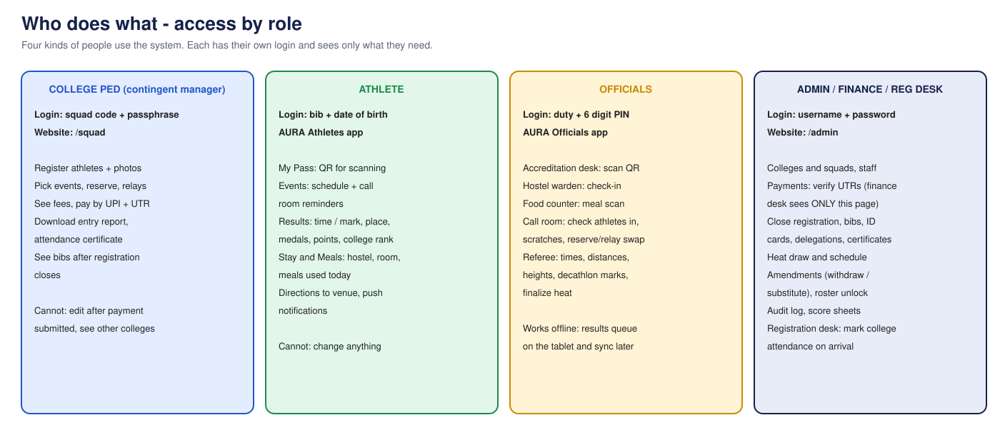
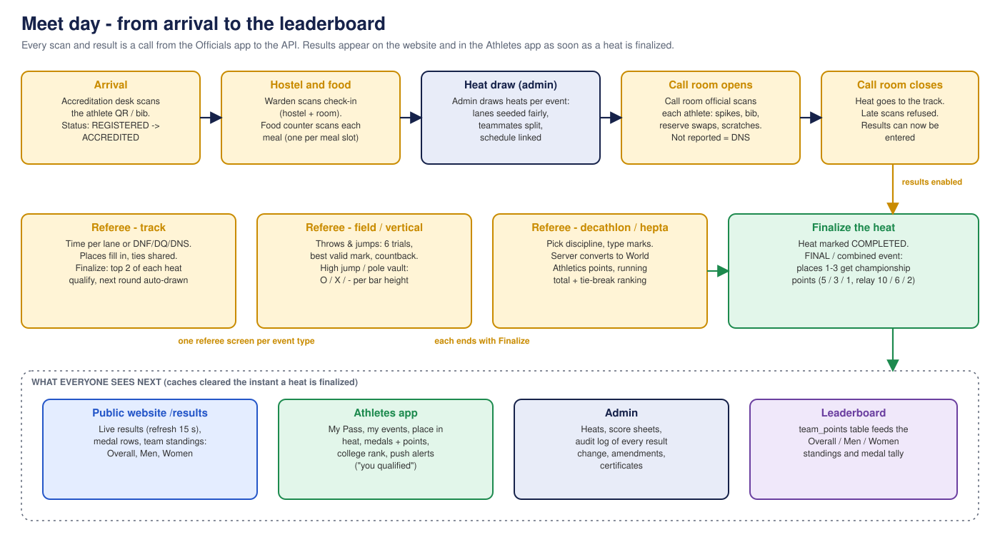

# How VTU SportsOS works - for everyone

This guide explains the system **without needing technical knowledge**. Each section tells one kind of
person what they do and what happens behind the scenes. The technical details are in
**[ARCHITECTURE.md](ARCHITECTURE.md)**.

**The event:** 28th VTU Inter-Collegiate State Level Athletic Meet 2026 (**Dr. ACS-AURA 2026**), hosted by
Dr. ACS College of Engineering, Bengaluru, under VTU, Belagavi. Meet days: **7-10 December 2026**.

---

## The system in one minute

Think of it as **four kinds of people** and **one shared notebook**:

| Person | Uses | What they do |
|---|---|---|
| **College PED** (Physical Education Director, contingent manager) | The website | Registers their athletes, picks events, pays the entry fee |
| **Athlete** | The *AURA Athletes* app | Shows their pass, sees their schedule, results and points |
| **Official** (desk staff, call room, referees) | The *AURA Officials* app | Scans people in, checks them into the call room, enters results |
| **Admin / Finance desk / Arrivals board** | The website | Runs the meet: colleges, payments, heat draw, ID cards, certificates |

The **shared notebook** is one database in the cloud. Everything anyone enters goes into it, and everything anyone
sees comes from it. That is why a result typed by a referee shows up on the public website and in the
athlete's app within seconds.

The rules of the meet (how many events, who can run, how points are given) are checked by the **system
itself**, not by the person using it. So a PED cannot register a third event for an athlete, and a referee cannot
type a world-record-breaking 100 m time by mistake.

---

## The journey of an athlete, start to finish

1. The admin creates the college. The college gets **two squads** (Men and Women), each with a login.
2. The PED registers athletes and picks their events.
3. The system works out the **fee**. The PED pays by UPI and uploads the proof.
4. The finance desk confirms the payment.
5. Registration closes and every athlete gets a permanent **bib number**.
6. The night before each event (until 22:00), the PED can swap a reserve in and pick the relay runners in the app.
7. At the meet: the college checks in at the accreditation desk (one scan) -> hostel -> meals -> roll call / call room -> track or field -> result -> medals.
8. After the meet: the athlete downloads a **Certificate of Participation** in the app.

---

## 1. For the college PED (contingent manager)

**Where:** the website, *Squad login* (squad code + passphrase). Men and Women squads log in separately.

### What you can do
| Page | What it is for |
|---|---|
| **Dashboard** | Your college, your squad, how many athletes, event quotas, payment status, bib numbers (after registration closes), advisory notes |
| **Athletes** | Add, edit and delete athletes. Pick events, a reserve and relays. |
| **Payment** | See the fee, pay by UPI, upload the receipt, see the status |
| **Certificate / reports** | Entry report, and the college's **Attendance Certificate**. It unlocks when your college checks in at the accreditation desk, and shows how many men and women **competed** (reported at a roll call or call room), so print it after your last event. |

### Adding an athlete
Fill in: full name **exactly as on the SSLC (10th) certificate**, **USN** (a first-year can use a temporary
USN, any text), semester, blood group, college joining date, the date this academic year started, date of
birth, student phone number (10 digits), **Aadhaar number (12 digits)**, and a **passport-size photo** (JPG, PNG or WebP, up to 5 MB).

The system rejects: an Aadhaar or USN already used by any college, dates that do not make sense, a missing photo,
or a wrong format.

### Choosing events
- Up to **2 individual events** per athlete.
- Up to **1 reserve event**. A reserve can only be named if the athlete has at least one regular individual
  event.
- At most **2 athletes from your college** in any one individual event.
- **Relays:** just tick 4x100 m, 4x400 m or the Mixed relay on the athlete's form. An athlete can be in **only
  one** of 4x100 or 4x400. There is no relay team building: the team is settled at the call room on the day.
  Up to 6 athletes per relay per squad, 6 per college for the Mixed relay.
- The **Half Marathon** can be entered as the only event.
- Decathlon (men) and Heptathlon (women) count as an event entry like the others.

### The fee
| Entry | Fee |
|---|---|
| Each individual or half marathon entry | Rs 100 |
| Reserve event | **free** |
| A relay team | Rs 100 for each of the first 4 members (members 5 and 6 free), up to Rs 400 |
| Mixed relay | Rs 100 for each of *your own* first 2 members |

**One payment per college.** Your Men's and Women's squads share one fee account. Either PED can pay the whole
college amount once.

### Paying
1. Pay the total by **UPI** to the host's UPI ID shown on the Payment page (a QR code is there).
2. Enter the **UTR / bank reference number** (8-30 letters or digits), the amount paid, and upload the screenshot or receipt.
3. Press submit.

### What happens when you submit
- Your roster is **locked** for **both** squads of your college. You can no longer add or delete athletes.
- The finance desk checks the payment against the bank:
  - **Verified** -> your reports and the ID cards can be printed. You are ready for the meet.
  - **Rejected** -> you will see the reason and can submit again.
- If you urgently need to change something after locking (a withdrawal, a substitution), ask the meet
  office. Only an admin can unlock a squad.

### Deadlines
Registration is open without a fine until **29 November 2026**, and until **30 November 2026** with a late fine of ₹1,000. The admin closes it after that, and then nothing can be added.

### At the meet: the PED in the AURA Athletes app
After registration, the PED also uses the **AURA Athletes app**. On the login screen choose **PED**, then enter
the **college code** and **either** the Men's or the Women's passphrase. One login covers both squads.

| What | How |
|---|---|
| **Swap a reserve in** | Put a reserve athlete into an individual event in place of a college athlete. A reserve who already has 2 individual events must give one up. |
| **Relay runners** | Pick the 4 running members and their legs for each relay from the athletes ticked on the form. |
| **Attendance** | For every event: who has reported at the roll call / call room, who has not, and who was marked DNS. |
| **Results** | Your college's marks and places as soon as a heat is finalized. |
| **Alerts** | Push notifications **30, 20 and 10 minutes** before a call room for athletes not yet reported, a DNS alert when the call room closes, and a result alert when the heat is finalized. |

**Swaps and relay runners close at 22:00 IST the day before the event**, and as soon as that event's roll
call opens. After that, changes are made only at the call room.

This does not reopen the website: the registration rules (no relay team building on the website) stay the same.

---

## 2. For the athlete

**Where:** the *AURA Athletes* app (Android and iPhone).
**Login:** your **bib number** and your **date of birth**. Bibs are issued after registration closes.

| Tab | What you see |
|---|---|
| **My Pass** | Your photo, name, college, bib number and a **QR code**. Show this at the hostel and food counter (and at the accreditation desk if your PED asks you to). Also shows whether you are accredited. |
| **Events** | Your events with day, time, heat and lane, a countdown, and the call room time. Reminders ring before your call room. |
| **Results** | Your time or mark, your place in the heat, medals, points earned, and your college's rank. For the decathlon and heptathlon you see your total points and place. |
| **Leaderboard** | Team standings: Overall, Men and Women |
| **More** | Stay and Meals (hostel, room, meals used today), directions to the venue, **Certificate**, settings, log out |

### Certificate of Participation
From the **day after the meet ends** (11 December 2026), open **More -> Certificate** and download your
certificate as a PDF. It lists the events you took part in. You get one if you **reported at a roll call or
call room for at least one event**, your own event or your relay team's. An athlete who registered but
never reported does not get one.

You also get **notifications**, for example when you qualify for the next round.

### Tips
- Keep the QR large and your screen bright when scanning.
- Report to the **call room** before your reporting time. If you are not scanned in when it closes, you are
  marked DNS (did not start) and cannot compete in that heat.
- The app is read-only: nothing you do in it changes any result.

---

## 3. For officials

**Where:** the *AURA Officials* app (Android tablets and phones). Choose your **duty** on the login screen and
enter your 6-digit **PIN**. The app remembers your last duty.

### The five duties

| Duty | Job | How |
|---|---|---|
| **Accreditation desk** | Check in a **college** when its contingent arrives | Scan **any one** athlete's QR of that college (or type one bib). The whole college is checked in and all its athletes are accredited. Works only if the college's payment is verified. |
| **Hostel warden** | Check athletes into the hostel | Scan the QR, pick the room. Refuses the wrong hostel. |
| **Food counter** | One meal per slot | Scan the QR for breakfast, lunch, snacks or dinner. A second scan for the same meal is refused. |
| **Call room** | Check athletes in before their heat | Open the heat, scan each athlete, inspect (spikes, bib), handle scratches and swaps, then close the call room |
| **Referee** | Enter the result | Times, distances, heights or decathlon marks, then Finalize |

### Accreditation desk: one scan per college
When a college's contingent arrives, scan the ID card of **any one** of its athletes. The screen says
**College checked in** with how many men and women are now accredited. That one scan:
- marks the college as present and unlocks its Attendance Certificate on the website;
- accredits **every athlete of both squads**, so they can be drawn into heats, report at the roll call and get meals.

Scanning a second athlete of the same college does no harm. It shows **College already checked in**, and picks up anyone
added since. Athletes added or reinstated later (late entries, substitutes) are accredited automatically.

The desk does **not** count heads. The real attendance comes from the roll call and call room: after the meet, every
college's count of athletes who **actually competed** is on the **Arrivals** page.

### Working offline
Wi-Fi at a stadium can be poor. The app **keeps working**:
- Athlete names, photos and fee status are stored on the tablet, so scanning still identifies people.
- Everything you scan or type is saved on the tablet first and shows **Queued**. It is sent automatically when the
  network returns. Sending twice does no harm.
- A badge at the top shows how many items are waiting and lets you check them.

### First round: the event roll call
The first round of an event does not start from heats. It starts from a **roll call for the whole event**:
1. Open the event's roll call. Every eligible entrant of the event is on it.
2. Athletes scan in. A relay team counts as reported when any of its runners scans. A reserve of the same
   college can come in for an absent athlete.
3. Press **Prepare heats**. The heats are drawn **only from the athletes who reported** and go straight to the
   referee. Everyone else is DNS. Heats drawn earlier by the meet office are thrown away and redrawn.

So there are no empty lanes in a first round. Later rounds (semi-finals, finals) use the per-heat call room below.

### Call room for later rounds (step by step)
1. Open your heat from the list. Open the call room.
2. As athletes arrive, scan their QR or type the bib. The athlete's photo, name and college appear.
3. Use the inspection to record spikes, bib and similar checks. Mark **scratched** or **disqualified** if needed.
4. If an athlete is absent, you can **substitute a reserve** (reserves are shown). For relays, swap a runner for a reserve.
5. **Close the call room.** The heat goes to the track. Anyone not scanned is now DNS.

> If the call room tablet has no internet, the referee can close the call room from the referee tablet, but
> only after the call room official types their own PIN on it.

### Referee: track events
- Each lane has: **Finished** (type the time like 10.42 or 1:52.34), **DNF**, **DQ** (with the rule) or **DNS**.
- Places fill in as times are typed, and equal times share a place.
- Everything saves itself after about a second. A small status shows *Saved*, *Saving* or *Queued*.
- Press **Finish heat**. If it is a heat, the best 2 of each heat go to the next round, drawn automatically with
  lanes. If it is the final, medals and points are awarded.

### Referee: throws and jumps
- Up to 6 trials per athlete. A trial is **a distance, a foul or a pass**. After 3 trials, only the best 8 continue.
- Positions are shown after 3, 5 and 6 trials, as on the paper card.

### Referee: high jump and pole vault
- For each bar height, record **O** (cleared), **X** (missed) or **-** (pass) per attempt. The system applies the
  official countback.

### Referee: decathlon and heptathlon
- Pick the discipline tab (Day 1 and Day 2 are grouped). The tab shows how many athletes have a mark.
- Type each athlete's mark: **times** like 10.42 or 1:52.34, **distances and heights in metres** like 7.42.
- The **points** appear straight away (World Athletics scoring), and the standings table below shows the running total and rank for every athlete.
- Statuses: **FIN** (finished), **NM** (no valid mark, scores 0 and the athlete stays in), **DNF/DQ/DNS** (the athlete is not ranked).
- **Print / Save PDF** gives the paper sheet: one table per day with each mark and its points, the grand total and the position.
- Press **Finish event & award points** when every mark is in.

### Rules referees should know
- You cannot enter results until the **call room closes**.
- You cannot enter a result for an athlete who **did not report**. Ask the call room official to correct it if it is a mistake.
- After you finalize, you cannot edit. Ask the meet office to reopen it. Every correction is logged with who made it.
- You only see events **assigned to you**.
- Impossible marks (for example a 5-second 100 m hurdles) are refused, so check what you typed.

---

## 4. For the admin, finance desk and arrivals board

**Where:** the website, *Admin login* (username and password). The **finance desk** account can open **only the
Payments page**. The **arrivals board** account (old name: registration desk) sees which colleges have checked in and how many athletes competed.

### Admin pages
| Page | Use |
|---|---|
| **Dashboard** | Totals at a glance, a registration open/closed switch, shortcuts |
| **Colleges** | Add a college, create its two squads and logins, reset passphrases, **unlock a squad** in an emergency |
| **Athletes** | Search and export every registered athlete |
| **Payments** | Review every payment: UTR, amount, receipt, then **Verify** or **Reject** (with a reason) |
| **Arrivals** | Which colleges have checked in, and per college how many men and women **competed** (reported at a roll call or call room at least once). A *Check in* button is a fallback if the accreditation app cannot scan. |
| **Bibs** | Generate contiguous bib numbers once registration closes (never change afterwards) |
| **ID cards** | Print athlete accreditation cards (admin-only; colleges do not see them) |
| **Heats / Schedule** | Draw heats for each event, see the schedule, link each heat to its slot |
| **Photo finish** | Work with the photo finish system for the 100/200/400 m, hurdles and relays. **App mode** (default): the system draws the heats, you export them as FinishLynx files and import the results back. **Manual mode**: the photo finish vendor makes the heats and you type the lane and bib for each. The referee still presses *Finish heat*. |
| **Results & Corrections** | Fix a result after a referee finished the heat: **reopen** the heat for the referee, or correct a track final time or a decathlon / heptathlon mark directly. A reason is required and goes in the Audit Log; places and points recalculate by themselves. |
| **Score sheets** | Print blank referee score sheets, including decathlon / heptathlon sheets (one page per day) |
| **Delegations** | Printable delegation sheets with the principal's signature and seal |
| **Certificates** | Generate the official certificates |
| **Amendments** | Withdraw or substitute an athlete after the roster is locked |
| **Staff** | Create officials accounts with PINs and event assignments for referees |
| **Audit log** | Who did what and when |

### The admin's run-up to the meet
1. Add colleges, hand out the squad codes and passphrases.
2. Registration open: PEDs register and pay. Finance verifies payments daily.
3. **Close registration**, then **generate bib numbers**.
4. Print ID cards, delegation sheets, score sheets.
5. On arrival days the accreditation desk checks in each college with one scan. The **Arrivals** page shows who is in.
6. **Draw heats** per event. Only accredited athletes of verified colleges are drawn, teammates in different heats.
7. On meet days: watch results, handle amendments, and keep an eye on the audit log.

### The finance desk
Opens **Payments**. For each submission: compare the UTR and amount with the bank statement, look at the receipt,
then **Verify** or **Reject**. Verifying one squad verifies the whole college's fee account.

---

## 5. For the public and spectators

Open the **Live Results** page (no login). It refreshes by itself every 15 seconds and shows:
- the **Overall, Men's and Women's team championships** with medal counts and points;
- every event with its heats, places and times or marks. Finals are highlighted with medal colours. Decathlon and heptathlon show total points.

Results appear as soon as a referee finalizes a heat.

---

## Scoring in plain words

| What | Points |
|---|---|
| **College points**: 1st, 2nd, 3rd in **any** event (individual or relay, decathlon and heptathlon included) | **10, 6, 2** |
| **Athlete's own points**: 1st, 2nd, 3rd in an individual event (used for Best Male / Female Athlete) | **5, 3, 1** |
| Mixed relay | no points |
| Tie | the tied athletes share the place |

Which events count where:
- **Overall championship:** college points from every event, individual and 4x100 m / 4x400 m relays.
- **Men's / Women's team championship:** college points from that gender's individual events only (no relays).

**Which events have heats:** only the **100 m, 200 m, 400 m, the hurdles and the relays**. Every other event
(800 m and longer, the walk, the half marathon, the field events) is a single race or flight, run as a straight final.

**Qualifying:** in events with several heats, the **first 2 of each heat** go to the next round (ties for
2nd place both go through). If more than 8 qualify for a final, a semi-final is run first.

**Decathlon and heptathlon:** each discipline gives points from the World Athletics tables, and the totals decide the places. Everyone must finish every discipline to be ranked. If two athletes have the same total, the one who scored higher in more disciplines wins.

---

## Glossary

| Term | Meaning |
|---|---|
| **PED** | Physical Education Director, the college's contingent manager |
| **Squad** | A college's Men or Women team. Each college has two. |
| **USN** | University Seat Number |
| **UTR** | The bank or UPI reference number of a payment |
| **Roster lock** | After payment is submitted, athletes can no longer be added or removed |
| **Bib** | The athlete's permanent number for the meet |
| **Accreditation** | The athlete is cleared to compete. Happens for the whole college at once when the college checks in at the accreditation desk. |
| **Call room** | The check-in area before a heat. Athletes not scanned in when it closes are DNS. |
| **Heat** | One race (or flight) of an event. Big events have several heats. |
| **DNS / DNF / DQ / NM** | Did not start / did not finish / disqualified / no valid mark |
| **Reserve** | A named substitute event, or an athlete who can step in at the call room |
| **Finalize** | The referee's "this heat is done and official" button |
| **Staging / production** | The practice copy of the system / the real one used at the meet |

---

## Questions people ask

**An athlete is missing from the heat draw.** Check three things: the athlete's college has *checked in* (so the athlete is *accredited*), the college's payment is
*verified*, and the athlete is *registered* for that event as a regular entry (a reserve is not drawn).

**A PED made a mistake after paying.** Roster is locked. Ask the meet office: an admin can withdraw or substitute
an athlete (Amendments) or unlock the squad.

**A referee typed a wrong time.** If the heat is not finalized, retype it (it saves over the old one). If it is
finalized, the admin opens **Results & Corrections** and either reopens the heat (the referee fixes it and finishes it
again) or corrects a final time / decathlon mark directly. The change is logged, and points recalculate automatically.

**A PED wants to change a relay runner or swap a reserve on the morning of the event.** The app closes this at
22:00 the night before. On the day, the call room official makes the swap at the roll call or call room.

**An athlete cannot download the certificate.** It opens only the day after the meet, and only for athletes who
reported at a roll call or call room at least once.

**The tablet lost Wi-Fi.** Keep working. Items show *Queued* and send themselves when the network returns.

**An athlete says they cannot log in to the app.** They need their **bib** (issued after registration closes) and
the **date of birth** exactly as registered. After many wrong tries the login pauses for 15 minutes.

**Where is a payment stuck?** The Payments page shows each payment as *Submitted*, *Verified* or *Rejected*. The
finance desk handles *Submitted*.

---

## Staging versus production

Staging (practice) vs production (real) are completely separate: staging has fictional demo data and is used
to rehearse. The real meet runs on production.

For more help on the website, see the **Support** page and the **Help manual** inside the website.
